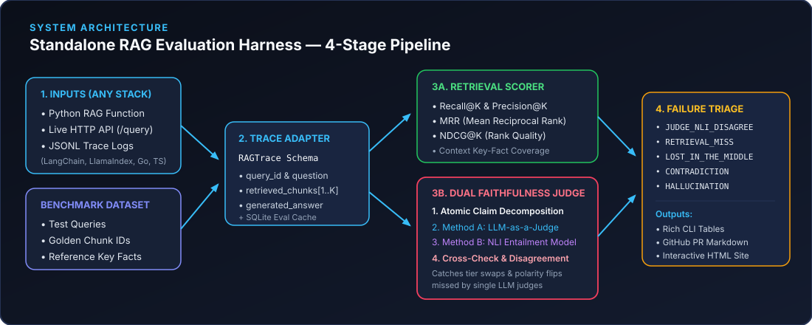
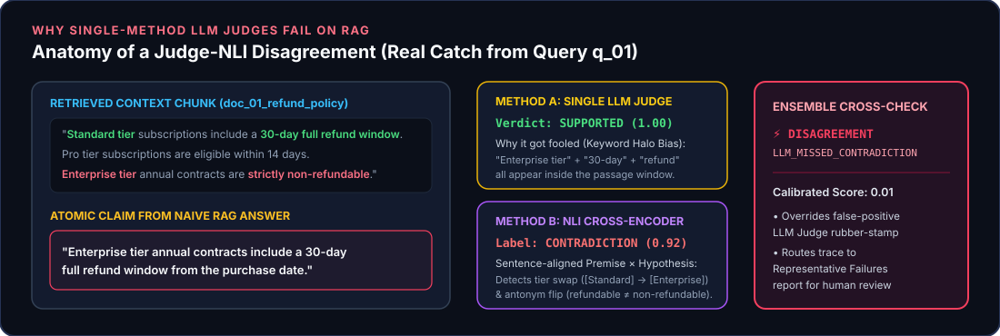
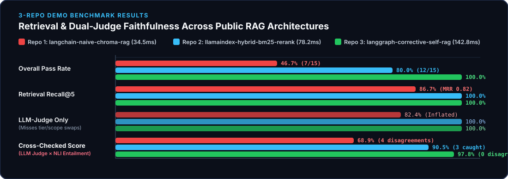

# Architecture, Codebase Structure & Design Decisions (`rag-eval-harness`)

This document explains **how `rag-eval-harness` works under the hood**, **how the codebase is organized**, **what alternative technical options exist**, and **why we chose this specific architecture**.

---

## 1. Visual System Architecture



### End-to-End Execution Flow
1. **Universal Pipeline Adapter (`src/rag_harness/adapters.py`):**
   Accepts *any* RAG system without requiring you to rewrite your application code in a specific framework:
   * **Mode 1 (`CallablePipelineAdapter`):** Calls any Python function `fn(question: str) -> dict` directly.
   * **Mode 2 (`HTTPPipelineAdapter`):** Sends `POST /query` requests to any running web service (`FastAPI`, `Node.js`, `Go`, `Spring`).
   * **Mode 3 (`TraceFileAdapter`):** Reads pre-recorded `.jsonl` or `.json` logs from disk—making the evaluator 100% language-agnostic.
2. **Information Retrieval Metrics Engine (`src/rag_harness/metrics/retrieval.py`):**
   Grades the retriever *independently* of the LLM generator using `Recall@K`, `Precision@K`, `MRR` (Mean Reciprocal Rank), `NDCG@K` (Normalized Discounted Cumulative Gain), `HitRate@K`, and `Context Fact Coverage`.
3. **Dual-Engine Faithfulness Cross-Checker (`src/rag_harness/metrics/ensemble.py`):**
   * **Step A (Atomic Claim Splitter):** Breaks the generated paragraph into individual factual claims (`src/rag_harness/metrics/claims.py`).
   * **Step B (Method 1 — LLM-as-a-Judge):** Evaluates high-level semantic support across the passage (`SUPPORTED`, `CONTRADICTED`, `UNVERIFIABLE`) with SQLite response caching (`src/rag_harness/metrics/llm_judge.py`).
   * **Step C (Method 2 — NLI Entailment Cross-Encoder):** Evaluates strict `(premise = retrieved sentence, hypothesis = atomic claim)` entailment (`ENTAILMENT`, `NEUTRAL`, `CONTRADICTION`), explicitly checking numeric figures, negation polarity, and entity/tier scope (`src/rag_harness/metrics/nli_judge.py`).
   * **Step D (Cross-Check & Disagreement Flagging):** Compares both judges. When the LLM Judge approves a fluent-sounding claim (`SUPPORTED`) that the NLI model catches as a `CONTRADICTION`, the claim is flagged as `LLM_MISSED_CONTRADICTION`.



4. **Root-Cause Failure Taxonomy (`src/rag_harness/triage/classifier.py`):**
   Every failed query is automatically assigned to one of 6 actionable engineering buckets with worst-K representative examples and concrete remediation steps:
   * `JUDGE_NLI_DISAGREEMENT` — LLM Judge fooled by keyword overlap; NLI caught a contradiction or tier swap.
   * `INTRINSIC_CONTRADICTION` — Generator misread numbers, dates, or negations in the retrieved passage.
   * `EXTRINSIC_HALLUCINATION` — Generator invented facts not present anywhere in the retrieved chunks.
   * `RETRIEVAL_MISS` — Retriever failed to surface the golden evidence chunk in top-K.
   * `LOST_IN_THE_MIDDLE` — Golden chunk was retrieved (e.g., at rank 4), but the generator ignored it or falsely abstained.
   * `INCOMPLETE_SYNTHESIS` — Generator answered only part of a multi-part or multi-chunk question.

---

## 2. Project Directory & File Structure

```text
rag-eval-harness/
├── pyproject.toml                         # Package config, dependencies & CLI entrypoints (`rag-harness`, `rageval`)
├── action.yml                             # Reusable GitHub Action so any repo can gate PRs on RAG metrics
├── app.py                                 # Interactive Streamlit web application (1-click Streamlit Cloud deploy)
├── ARCHITECTURE.md                        # Deep-dive architecture, file map & design trade-offs (this file)
├── README.md                              # Quickstart, CLI reference & benchmark overview
├── .github/workflows/
│   └── ci-and-pages.yml                   # GitHub Actions CI (runs pytest + benchmark + auto-deploys GitHub Pages)
├── docs/
│   ├── index.html                         # Self-contained interactive HTML dashboard + live browser sandbox
│   └── assets/                            # Vector SVG architecture & benchmark comparison diagrams
│       ├── architecture_pipeline.svg
│       ├── dual_judge_crosscheck.svg
│       └── benchmark_comparison.svg
├── src/rag_harness/
│   ├── __init__.py                        # Public Python library exports (`RAGEvaluator`, schemas, adapters)
│   ├── schemas.py                         # Strict Pydantic v2 data contracts for traces, claims & reports
│   ├── adapters.py                        # Universal adapters: Python callable, HTTP webhook, JSONL trace file
│   ├── evaluator.py                       # Top-level `RAGEvaluator` orchestrator
│   ├── cli.py                             # Typer + Rich CLI (`run`, `benchmark`, `check-claim`, `export-dataset`)
│   ├── metrics/
│   │   ├── retrieval.py                   # Recall@K, Precision@K, MRR, NDCG@K, HitRate & Fact Coverage
│   │   ├── claims.py                      # Atomic claim decomposition & abstention detection
│   │   ├── llm_judge.py                   # LLM-as-a-Judge verifier + SQLite response cache (`JudgeCache`)
│   │   ├── nli_judge.py                   # Sentence-aligned NLI Entailment Cross-Encoder (Local + DeBERTa-v3)
│   │   └── ensemble.py                    # Dual-engine cross-checker & disagreement detector
│   ├── triage/
│   │   └── classifier.py                  # Root-cause failure taxonomy & Representative Failures builder
│   ├── reporting/
│   │   ├── terminal.py                    # Rich color-coded CLI tables & failure panels
│   │   ├── markdown.py                    # GitHub-Flavored Markdown generator for PR comments & step summaries
│   │   └── html_dashboard.py              # Standalone interactive HTML dashboard generator
│   └── demos/
│       ├── corpus.py                      # 18-chunk technical SaaS corpus + 15-query golden benchmark dataset
│       └── public_repos.py                # 3 runnable public RAG architectures (Naive, Hybrid+Rerank, Corrective)
├── benchmarks/
│   ├── BENCHMARK_REPORT.md                # Full Markdown benchmark report across the 3 RAG architectures
│   ├── datasets/                          # Exported JSON benchmark questions & knowledge corpus
│   ├── reports/                           # Per-pipeline JSON and Markdown evaluation reports
│   └── traces/                            # Recorded JSONL execution traces for each benchmarked RAG repo
├── examples/
│   └── custom_rag_pipeline.py             # Minimal 10-line wrapper showing how to plug in any Python RAG app
└── tests/
    └── test_harness.py                    # Pytest suite verifying IR math, NLI cross-checks, triage & CLI
```

---

## 3. Architectural Trade-Offs: Other Options vs. Why We Chose This Stack

### Decision 1: How to Score Faithfulness / Hallucinations

| Option | How It Works | Pros | Cons / Failure Modes |
| :--- | :--- | :--- | :--- |
| **Option A: Single LLM-as-a-Judge Only** *(Default in RAGAS, TruLens, DeepEval)* | Prompts GPT-4 / Claude to score whether the answer is grounded in the context. | Understands broad conceptual paraphrases. | **Keyword-Halo & Sycophancy Bias:** If a RAG answer swaps numbers or policies between two tiers that both appear in the passage, single LLM judges frequently score it `1.0 (SUPPORTED)`. Also high API latency & cost. |
| **Option B: Pure NLI Cross-Encoder Only** *(e.g., DeBERTa-MNLI / AlignScore alone)* | Scores `(premise, hypothesis)` pairs with a small classification model. | Deterministic, fast, runs locally on CPU for $0, catches negations. | Can be overly strict (`NEUTRAL`) when an answer summarizes or paraphrases across multiple sentences without providing a human-readable explanation. |
| **Option C: Lexical Overlap** *(BLEU / ROUGE / BERTScore)* | Measures n-gram or embedding similarity between answer and context. | Instant computation. | Completely blind to factual reversals (`"Enterprise is refundable"` vs `"Enterprise is non-refundable"` has 92% token overlap!). |
| **✅ Our Choice: Dual-Engine Cross-Check (LLM Judge × NLI Entailment)** | Decomposes answers into atomic claims, runs **both** an LLM Judge and a sentence-aligned NLI model, and cross-checks them. | Combines semantic reasoning with strict entity/number/polarity verification; explicitly surfaces **Judge-NLI Disagreements**. | Slightly more orchestration code—which this library encapsulates cleanly. |

---

### Decision 2: Standalone CLI/Library vs. Framework-Locked Eval vs. SaaS Platform

| Option | Pros | Cons | Why We Chose Standalone CLI + Library |
| :--- | :--- | :--- | :--- |
| **Buried In-App Script / Notebook** | Quick for 5 manual test queries. | Cannot be reused across repos; breaks when switching from LangChain to LlamaIndex or custom code. | Production agent post-mortems consistently show the **eval harness and trace log** outlive any orchestration framework. |
| **Hosted SaaS Observability Platform** *(LangSmith, Arize, Patronus)* | Polished cloud UI. | Requires sending proprietary documents/traces to a third-party cloud; vendor lock-in; paid seats. | By publishing a standalone CLI (`rag-harness`) that reads standard `.jsonl` traces, teams can run everything locally or inside GitHub Actions for free. |
| **✅ Standalone CLI + 3-Mode Universal Adapter** | Works on Python functions, HTTP servers, or `.jsonl` trace logs from **any** language; generates static HTML & Markdown reports. | None—gives both CLI speed and interactive HTML/Streamlit visualization. | Lets you evaluate 3 completely different RAG architectures side-by-side with the exact same command. |

---

### Decision 3: Two-Tier Pluggable Model Backend (Zero-Config Local + Optional Cloud/HF)

A common problem with open-source eval tools is that `pytest` or GitHub Actions CI immediately fails if the user doesn't configure a paid `OPENAI_API_KEY` or download a 1.8 GB PyTorch checkpoint on every runner.

**Why we built a Two-Tier Pluggable Architecture:**
1. **Default Tier (Zero-Config / Instant CI):**
   * `NLIEvaluator(backend="local")` uses a deterministic structural-linguistic NLI analyzer that checks sentence-level entity scope, antonym pairs, negation polarity, and numeric consistency in `<5 ms` on CPU with zero external downloads.
   * `LLMJudgeEvaluator` includes a passage-level semantic rubric fallback + **SQLite response caching (`JudgeCache`)**.
2. **Production Scale-Up Tier (1 Flag Switch):**
   * Pass `--nli-backend transformers` to load Hugging Face `CrossEncoder("cross-encoder/nli-deberta-v3-base")`.
   * Set `OPENAI_API_KEY` (or `RAG_JUDGE_API_BASE` for Gemini / Ollama / vLLM) and pass `--judge-model gpt-4o-mini` to run live structured LLM judge calls with automatic SQLite caching.


