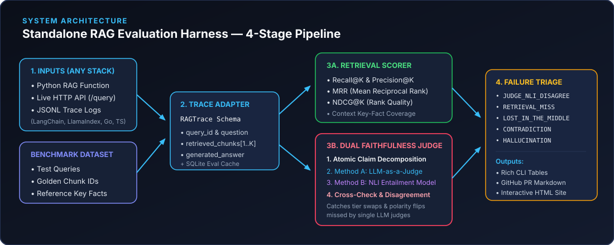
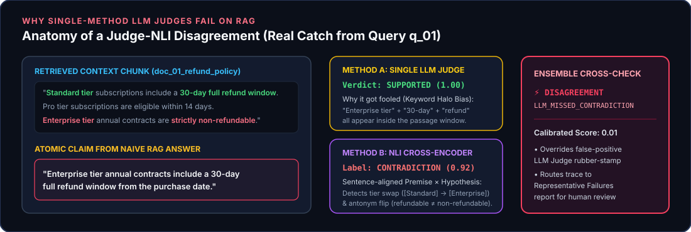
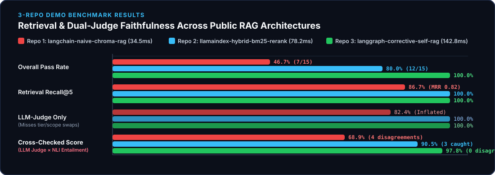

# `rag-eval-harness` — Standalone RAG Evaluation CLI & Library

[](https://rageval-benchmark.streamlit.app)
[](https://github.com/velagapudirushi/rag-eval-harness/actions)
[](pyproject.toml)
[](ARCHITECTURE.md)
[](LICENSE)

🚀 **Live Web Evaluator & Benchmark Suite:** [**https://rageval-benchmark.streamlit.app**](https://rageval-benchmark.streamlit.app) *(Evaluate any custom `.jsonl`/`.json`/`.csv` RAG logs, test a live RAG HTTP API endpoint, or inspect the 3-repo benchmark)*

**Stop burying throwaway evaluation scripts inside individual RAG apps—and stop trusting a single LLM-as-a-Judge prompt.**

`rag-eval-harness` (`rageval`) is a standalone, framework-agnostic CLI and Python library that takes **any RAG pipeline** (via a Python function, HTTP webhook, or JSONL trace file) plus a question dataset and returns:

1. **Information Retrieval Metrics:** `Recall@K`, `Precision@K`, `MRR` (Mean Reciprocal Rank), `NDCG@K`, `HitRate@K`, and `Context Fact Coverage`.
2. **Dual-Engine Cross-Checked Faithfulness:** Breaks each generated answer into atomic factual claims and cross-checks an **LLM-as-a-Judge** against a sentence-aligned **Natural Language Inference (NLI) Entailment Cross-Encoder**—catching subtle tier swaps, numeric mismatches, and negation flips where holistic LLM judges get fooled by passage-level keyword overlap.
3. **Representative Failure Triage Report:** Automatically groups failed queries into actionable root-cause buckets (`JUDGE_NLI_DISAGREEMENT`, `RETRIEVAL_MISS`, `LOST_IN_THE_MIDDLE`, `INTRINSIC_CONTRADICTION`, `EXTRINSIC_HALLUCINATION`) with concrete worst-K examples and engineering remediation hints.

> 📖 **Deep-Dive Documentation:** See [**`ARCHITECTURE.md`**](ARCHITECTURE.md) for the full system design, file-by-file codebase map, and architectural trade-off comparisons, or [**`benchmarks/BENCHMARK_REPORT.md`**](benchmarks/BENCHMARK_REPORT.md) for the full 3-repo failure report.

---

## 1. Visual System Architecture



---

## 2. Why Cross-Check an LLM Judge Against an NLI Entailment Model?

Most RAG evaluation tools rely on a single LLM-as-a-Judge call (`"Grade if this answer is faithful to the context"`). In production, holistic LLM judges suffer from **Keyword-Halo Bias**: when a RAG answer swaps rules or numbers between two tiers that *both* appear inside the retrieved passage, the LLM judge often approves it (`SUPPORTED`).

Cross-checking each atomic claim against a **sentence-aligned NLI Entailment Cross-Encoder** (`premise = retrieved sentence`, `hypothesis = atomic claim`) catches these failures deterministically:



### Design Options Compared: Why We Chose This Approach

| Evaluation Approach | Catches Subtle Number / Tier Swaps? | Understands Paraphrases? | Cost & Latency | Why We Chose / Rejected It |
| :--- | :---: | :---: | :---: | :--- |
| **Single LLM-as-a-Judge Only** *(Standard in RAGAS / TruLens)* | ❌ Often fooled by keyword overlap | ✅ Yes | 💸 High API cost & slow | **Rejected as sole judge:** Rubber-stamps plausible hallucinations when entities/numbers appear elsewhere in the same chunk. |
| **NLI Model Only** *(DeBERTa / MiniCheck alone)* | ✅ Strict on numbers & negations | ⚠️ Can be overly strict on summaries | ⚡ Fast, $0 local CPU | **Rejected as sole judge:** Lacks human-readable reasoning chains and can penalize valid high-level syntheses. |
| **Lexical Overlap** *(BLEU / ROUGE / BERTScore)* | ❌ Blind to `"refundable"` vs `"non-refundable"` | ❌ Poor | ⚡ Instant | **Rejected:** High word overlap does not mean factual entailment. |
| **✅ Our Choice: Dual-Engine Cross-Check (LLM Judge × NLI Entailment)** | **✅ Yes (Flags `LLM_MISSED_CONTRADICTION`)** | **✅ Yes** | **⚡ Fast + SQLite Cached** | **Selected:** Combines LLM semantic reasoning with strict NLI premise-hypothesis verification and surfaces **Judge-NLI Disagreements**. |

---

## 3. Demo Benchmark: Running Against 3 Public RAG Architectures



Full trace-by-trace results are in [`benchmarks/BENCHMARK_REPORT.md`](benchmarks/BENCHMARK_REPORT.md) and [`docs/index.html`](docs/index.html):

| RAG Repo / Architecture | Pass Rate | Recall@5 | MRR | NDCG@5 | LLM-Judge Only | NLI Entailment | **Cross-Checked Faithfulness** | Judge-NLI Disagreements | Mean Latency |
| :--- | :---: | :---: | :---: | :---: | :---: | :---: | :---: | :---: | :---: |
| **`langchain-naive-chroma-rag`** | **46.7%** (7/15) | `86.7%` | `0.817` | `0.829` | `82.4%` | `69.0%` | **68.9%** | `4/31` (12.9%) | `34.5 ms` |
| **`llamaindex-hybrid-bm25-rerank`** | **80.0%** (12/15) | `100.0%` | `1.000` | `1.000` | `100.0%` | `88.1%` | **90.5%** | `3/26` (11.5%) | `78.2 ms` |
| **`langgraph-corrective-self-rag`** | **100.0%** (15/15) | `100.0%` | `1.000` | `1.000` | `100.0%` | `95.0%` | **97.8%** | `0/25` (0.0%) | `142.8 ms` |

---

## 4. Repository Structure

```text
rag-eval-harness/
├── ARCHITECTURE.md                        # Detailed architecture, ADRs & alternative stack trade-offs
├── README.md                              # Overview, visual diagrams & CLI quickstart
├── pyproject.toml                         # Python package config & CLI entrypoints (`rag-harness`, `rageval`)
├── action.yml                             # Reusable GitHub Action for gating PRs in any repo
├── app.py                                 # Interactive Streamlit web dashboard
├── docs/
│   ├── index.html                         # GitHub Pages interactive dashboard + live browser sandbox
│   └── assets/                            # SVG architecture & benchmark diagrams
├── src/rag_harness/
│   ├── schemas.py                         # Pydantic v2 models (QuestionItem, RAGTrace, HarnessReport)
│   ├── adapters.py                        # Universal adapters (Python callable, HTTP webhook, JSONL trace)
│   ├── evaluator.py                       # Core RAGEvaluator orchestrator
│   ├── cli.py                             # Typer + Rich CLI commands
│   ├── metrics/
│   │   ├── retrieval.py                   # Recall@K, Precision@K, MRR, NDCG@K, Context Fact Coverage
│   │   ├── claims.py                      # Atomic claim splitter & abstention detector
│   │   ├── llm_judge.py                   # LLM-as-a-Judge verifier + SQLite cache
│   │   ├── nli_judge.py                   # Sentence-aligned NLI Entailment Cross-Encoder (Local + DeBERTa)
│   │   └── ensemble.py                    # Dual-judge cross-checker & disagreement detector
│   ├── triage/
│   │   └── classifier.py                  # Root-cause failure taxonomy & Representative Failures builder
│   ├── reporting/                         # Rich terminal, GitHub Markdown & static HTML generators
│   └── demos/                             # 18-chunk SaaS corpus, 15 queries & 3 public RAG repo pipelines
├── benchmarks/                            # Generated JSONL traces, JSON/MD reports & BENCHMARK_REPORT.md
├── examples/custom_rag_pipeline.py        # 10-line adapter example for any custom Python RAG app
└── tests/test_harness.py                  # Pytest unit & integration test suite
```

---

## 5. Quickstart

### Install
```bash
git clone https://github.com/velagapudirushi/rag-eval-harness.git
cd rag-eval-harness
pip install -e ".[dev]"
```

*(Optional extras: `pip install -e ".[nli,llm,web]"` to install HuggingFace `sentence-transformers` DeBERTa-v3 weights, `litellm`, and `streamlit`.)*

### Run the 3-Repo Benchmark & Generate Reports
```bash
rag-harness benchmark --output-dir benchmarks --docs-html docs/index.html
```

### Evaluate Any Custom RAG Pipeline

* **Python Function (`examples/custom_rag_pipeline.py`):**
  ```bash
  rag-harness run --pipeline examples/custom_rag_pipeline.py:run_rag --output-md report.md --output-html report.html
  ```
* **Pre-Recorded JSONL Traces (Any Language: TypeScript, Go, Rust, Python):**
  ```bash
  rag-harness run --traces benchmarks/traces/langchain-naive-chroma-rag.traces.jsonl
  ```
* **Live HTTP Endpoint (`POST /query`):**
  ```bash
  rag-harness run --endpoint http://localhost:8000/query --fail-under-faithfulness 0.85 --fail-under-recall 0.90
  ```
* **Inline Claim Cross-Check in Terminal:**
  ```bash
  rag-harness check-claim \
    --context "Standard plans have a 30-day refund window. Enterprise plans are strictly non-refundable." \
    --answer "Enterprise plans include a 30-day refund window."
  ```
