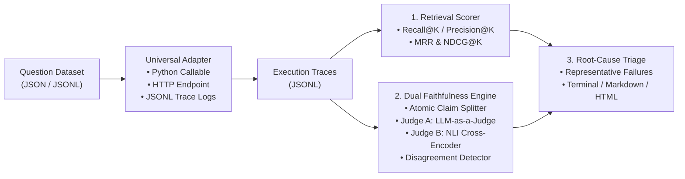

# `rag-eval-harness` — Standalone RAG Evaluation CLI & Library

[](#)
[](#)
[](LICENSE)

**Stop burying throwaway evaluation scripts inside individual RAG apps—and stop trusting a single LLM-as-a-Judge prompt.**

`rag-eval-harness` (`rageval`) is a standalone, framework-agnostic CLI and Python library that takes **any RAG pipeline** (via a Python function, HTTP webhook, or JSONL trace file) plus a question dataset and produces:

1. **Information Retrieval Metrics:** `Recall@K`, `Precision@K`, `MRR` (Mean Reciprocal Rank), `NDCG@K`, `HitRate@K`, and `Context Fact Coverage`.
2. **Dual-Engine Cross-Checked Faithfulness:** Breaks each generated answer into atomic factual claims and cross-checks an **LLM-as-a-Judge** against a sentence-aligned **Natural Language Inference (NLI) Entailment Cross-Encoder**—catching subtle tier swaps, numeric mismatches, and negation flips where holistic LLM judges get fooled by passage-level keyword overlap.
3. **Representative Failure Triage Report:** Automatically groups failed queries into actionable root-cause buckets (`JUDGE_NLI_DISAGREEMENT`, `RETRIEVAL_MISS`, `LOST_IN_THE_MIDDLE`, `INTRINSIC_CONTRADICTION`, `EXTRINSIC_HALLUCINATION`) with concrete worst-K examples and engineering remediation hints.

---

## Architecture Overview



---

## Demo Benchmark: Running Against 3 Public RAG Architectures

Included in [`benchmarks/BENCHMARK_REPORT.md`](benchmarks/BENCHMARK_REPORT.md) and [`docs/index.html`](docs/index.html) is a full benchmark run across 3 canonical open-source RAG architectures:

| RAG Repo / Architecture | Pass Rate | Recall@5 | MRR | NDCG@5 | LLM-Judge Only | NLI Entailment | **Cross-Checked Faithfulness** | Judge-NLI Disagreements | Mean Latency |
| :--- | :---: | :---: | :---: | :---: | :---: | :---: | :---: | :---: | :---: |
| **`langchain-naive-chroma-rag`** | **46.7%** (7/15) | `86.7%` | `0.817` | `0.829` | `82.4%` | `69.0%` | **68.9%** | `4/31` (12.9%) | `34.5 ms` |
| **`llamaindex-hybrid-bm25-rerank`** | **80.0%** (12/15) | `100.0%` | `1.000` | `1.000` | `100.0%` | `88.1%` | **90.5%** | `3/26` (11.5%) | `78.2 ms` |
| **`langgraph-corrective-self-rag`** | **100.0%** (15/15) | `100.0%` | `1.000` | `1.000` | `100.0%` | `95.0%` | **97.8%** | `0/25` (0.0%) | `142.8 ms` |

### Why Cross-Checking LLM-Judge with NLI Matters (Real Catch from `q_01`)
* **Query (`q_01`):** *"What is the refund window for Enterprise tier annual contracts?"*
* **Retrieved Passage (`doc_01`):** *"Standard tier subscriptions include a 30-day full refund window... Enterprise tier annual contracts are strictly non-refundable once provisioned..."*
* **Naive RAG Answer:** *"Enterprise tier annual contracts include a 30-day full refund window from the purchase date."*
* **Single LLM-Judge Verdict:** `SUPPORTED (1.00)` — fooled because `"Enterprise tier"`, `"30-day"`, and `"refund window"` all appear in the passage.
* **NLI Cross-Encoder Verdict:** `CONTRADICTION (p_contra=0.92)` — detects the entity scope swap between `Standard` and `Enterprise` and flags `[LLM_MISSED_CONTRADICTION]`.

---

## Quickstart

### 1. Install
```bash
git clone https://github.com/velagapudirushi/rag-eval-harness.git
cd rag-eval-harness
pip install -e ".[dev]"
```

*(Optional extras: `pip install -e ".[nli,llm,web]"` to install HuggingFace `sentence-transformers` DeBERTa-v3 weights, `litellm`, and `streamlit`.)*

### 2. Run the 3-Repo Benchmark & Generate Reports
```bash
rag-harness benchmark --output-dir benchmarks --docs-html docs/index.html
```

### 3. Evaluate Any Custom RAG Pipeline

**Option A — Evaluate a Python Function (`examples/custom_rag_pipeline.py`):**
```bash
rag-harness run \
  --pipeline examples/custom_rag_pipeline.py:run_rag \
  --dataset benchmarks/datasets/cloud_rag_benchmark.json \
  --output-md report.md \
  --output-html report.html
```

**Option B — Evaluate Pre-Recorded JSONL Traces (Any Language: TypeScript, Go, Rust, Python):**
```bash
rag-harness run \
  --traces benchmarks/traces/langchain-naive-chroma-rag.traces.jsonl \
  --dataset benchmarks/datasets/cloud_rag_benchmark.json
```

**Option C — Evaluate a Live HTTP Endpoint (`POST /query`):**
```bash
rag-harness run \
  --endpoint http://localhost:8000/query \
  --dataset benchmarks/datasets/cloud_rag_benchmark.json \
  --fail-under-faithfulness 0.85 \
  --fail-under-recall 0.90
```

**Option D — Inline Claim Cross-Check in Terminal:**
```bash
rag-harness check-claim \
  --context "Standard plans have a 30-day refund window. Enterprise plans are strictly non-refundable." \
  --answer "Enterprise plans include a 30-day refund window."
```

---

## Use as a GitHub Action in Any Repository

Because this repo includes [`action.yml`](action.yml), any project can run `rag-eval-harness` in CI to block Pull Requests that degrade retrieval or introduce hallucinations:

```yaml
- name: Run RAG Evaluation Gate
  uses: velagapudirushi/rag-eval-harness@main
  with:
    pipeline: "my_rag_app.py:run_rag"
    dataset: "tests/rag_questions.json"
    fail_under_faithfulness: "0.85"
    fail_under_recall: "0.90"
```

---

## Deploying to GitHub (GitHub Pages + Actions + Streamlit)

1. **Push to GitHub:**
   ```bash
   git init
   git add .
   git commit -m "feat: standalone RAG eval harness with dual LLM+NLI judge and 3-repo benchmark"
   git branch -M main
   git remote add origin https://github.com/velagapudirushi/rag-eval-harness.git
   git push -u origin main
   ```
2. **Enable Live Interactive Dashboard on GitHub Pages:**
   * Go to your GitHub repo **Settings → Pages**.
   * Under **Build and deployment**, select **GitHub Actions** (configured automatically by [`.github/workflows/ci-and-pages.yml`](.github/workflows/ci-and-pages.yml)) *or* select **Deploy from a branch → `main` → `/docs`**.
   * Your interactive report + live in-browser Dual-Judge Sandbox will be live at `https://velagapudirushi.github.io/rag-eval-harness/`.
3. **Optional 1-Click Streamlit Cloud App:**
   * Connect your GitHub repo on [share.streamlit.io](https://share.streamlit.io) and select [`app.py`](app.py) as the entrypoint.
